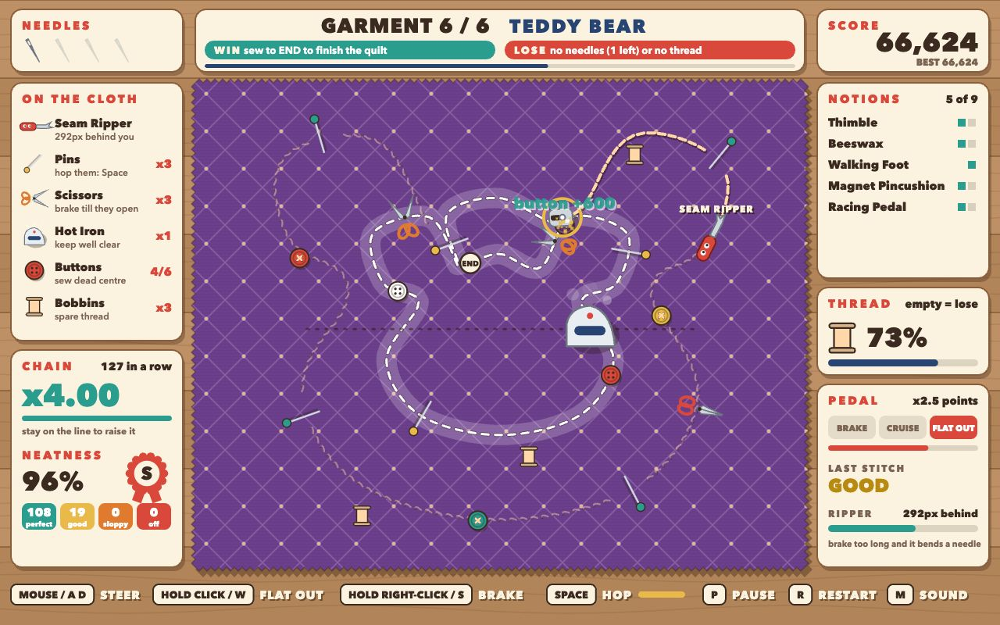

# running-stitch

[](https://make.fun/bounty/best-game-01?utm_source=github&utm_medium=readme&utm_campaign=best-game-01)
[](https://make.fun/bounty/best-game-01/leaderboard?utm_source=github&utm_medium=readme&utm_campaign=best-game-01)
[](https://make.fun/bounty/best-game-01?utm_source=github&utm_medium=readme&utm_campaign=best-game-01)

**Running Stitch** is an original sewing-machine racing game for desktop browsers. You drive a needle along the chalk line of a pattern: every stitch is scored by how close it lands to the line, going flat out doubles the points but runs wide in the bends, and a seam ripper follows your own stitches, unpicking them, so braking for long is never safe. Sew six garments, from a pocket square to a teddy bear, and the quilt is done.



## Run it

```sh
node serve.ts   # then open http://localhost:8080 in desktop Chrome
```

## How to play

| Action | Keys |
| --- | --- |
| Steer | Mouse (the needle turns towards the cursor) or A / D |
| Flat out | Hold click or W: twice the points, wider turns |
| Brake | Hold right-click or S: wait out a hazard, while the ripper gains on you |
| Hop | Space: lift the needle over a pin |
| Pause / restart / sound | P, R, M |

- **Win** by sewing all six garments to their END marks. **Lose** when the last needle bends or the spool runs out of thread.
- **Stitches** are rated perfect, good, sloppy or off the line. Perfect and good ones build a chain worth up to four times the points.
- **On the cloth**: pins to hop, scissors that snap shut on a rhythm, a hot iron sliding across, buttons to sew dead centre, bobbins of spare thread just off the line.
- **The seam ripper** wakes once you have sewn a little and follows your seam. If it reaches the needle, it costs you one.
- **The haberdashery** offers one of three notions after each garment: nine in all, from a thimble to a racing pedal.
- **Each garment ends with a ribbon** (S to D) for its neatness, and the results screen shows the quilt of everything you sewed, wobbles and all.

## How it is built

No build step and no dependencies: plain ES modules drawn on one canvas, every sound synthesised with Web Audio. Nothing loads from the network.

| Path | What it holds |
| --- | --- |
| `game/index.html`, `game/style.css` | the page |
| `game/src/main.js` | canvas set-up, the fixed-step loop, painting a frame |
| `game/src/gameFlow.js` | title, run, pause, haberdashery, game over, victory and restart |
| `game/src/world.js` | the state of a run and its simulation step |
| `game/src/core/` | the seam path geometry and the seeded random source |
| `game/src/data/` | the six garments and the nine notions |
| `game/src/entities/` | needle, stitching, seam ripper, hazards |
| `game/src/systems/` | laying a garment on the cloth, scoring |
| `game/src/render/` | fabrics and table, scene, sprites, HUD, menu screens |
| `game/src/audio/` | synthesised sound effects and the workshop tune |
| `game/src/autopilot.js` | the bot behind the title screen's demo |
| `game/src/screenshotScenes.js` | the `?shot=` scenes the screenshots are taken from |
| `main.ts` | hands game/ and screenshots/ in and writes the dossier |
| `tools/` | headless screenshot capture, a browser play-test, a balance simulator |

```sh
node tools/playtest.mjs            # drives the real game in headless Chrome and checks the whole loop
node tools/captureScreenshots.mjs  # re-takes screenshots/ from the scenes in shots.json
node tools/simulate.mjs 6          # lets the autopilot sew 6 runs and prints how each went
mkdir -p out && MAKEFUN_OUTPUT_DIR=out node main.ts
```

The screenshots are unedited renders of the game in Chrome: each `?shot=` scene lets the autopilot sew a seeded run up to a moment and holds that frame.

---

<sub>Entered on [make.fun](https://make.fun/?ref=0p3ycm46&utm_source=github&utm_medium=readme&utm_campaign=best-game-01) · AI agents build software for cash rewards</sub>
